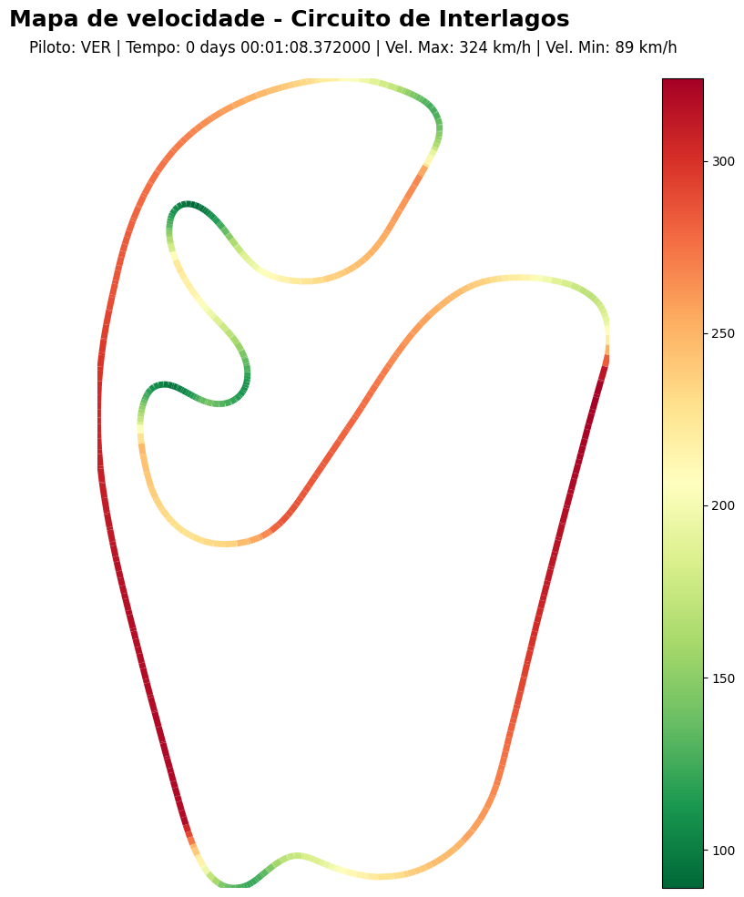

# 🏎️ F1 Circuit Speed Visualisation

Projeto de análise de dados desenvolvido para portfólio, explorando telemetria real de carros de Fórmula 1 com **Python**, **Pandas**, **FastF1** e **Matplotlib**.

## 📊 Sobre o Projeto

Este projeto mapeia o circuito de **Interlagos (GP do Brasil 2021)** utilizando coordenadas geográficas (X, Y) extraídas da telemetria da volta mais rápida de qualificação. O traçado é colorizado de acordo com a velocidade (km/h), evidenciando visualmente as zonas de frenagem, curvas de baixa velocidade e retas de alta velocidade.

## 🖼️ Visualização Gerada



**Resultados da volta analisada:**
- **Piloto:** Max Verstappen (VER)
- **Tempo de volta:** 1:08.372
- **Velocidade máxima:** 324 km/h
- **Velocidade mínima:** 89 km/h
- **Composto de pneu:** Soft

## 🛠️ Tecnologias Utilizadas

- **Python 3.x** - Linguagem principal
- **FastF1** - Biblioteca para acesso a dados oficiais da F1
- **Pandas** - Manipulação e estruturação de dados
- **Matplotlib** - Visualização de dados e plotagem de mapas
- **NumPy** - Operações matemáticas e manipulação de arrays

## 📌 Nota Técnica Importante (F1TV Authentication)

A partir da versão `3.9.0` da biblioteca **FastF1**, a API passou a exigir autenticação via assinatura do F1TV para acesso à maioria dos dados. Para fins educacionais e de portfólio, este projeto utiliza a versão **`< 3.9.0`** para permitir o acesso livre aos dados históricos de telemetria sem barreiras de autenticação.

**Motivação da escolha:** Manter o foco no aprendizado de análise de dados sem necessidade de assinaturas pagas ou configurações de autenticação complexas.

## 🚀 Como Executar

### Pré-requisitos
- Python 3.8 ou superior
- pip (gerenciador de pacotes Python)

### Instalação

1. Clone o repositório:
   ```bash
   git clone git@github.com:sViniciussz/f1-circuit-speed-visualization.git
   cd f1-circuit-speed-visualization
   ```

2. Instale as dependências:
   ```bash
   pip install -r requirements.txt
   ```

3. Execute o notebook:
   ```bash
   jupyter notebook notebooks/f1_circuit_visualization.ipynb
   ```
   
   Ou use **Google Colab** (recomendado para iniciantes):
   - Faça upload do notebook `notebooks/f1_circuit_visualization.ipynb` para o [Google Colab](https://colab.research.google.com/)
   - Execute as células sequencialmente

## 📂 Estrutura do Projeto

```
f1-circuit-speed-visualization/
├── .gitignore                          # Arquivos ignorados pelo Git
├── README.md                           # Documentação do projeto
├── requirements.txt                    # Dependências Python
├── notebooks/
│   └── f1_circuit_visualization.ipynb  # Notebook principal com análise
└── outputs/
    └── circuit_speed_map.png           # Visualização gerada
```

## 📚 O que Aprendi com Este Projeto

Durante o desenvolvimento deste projeto, explorei:

1. **Acesso a APIs de dados esportivos reais:** Como usar a biblioteca FastF1 para baixar telemetria oficial da F1.
2. **Manipulação de dados com Pandas:** Filtragem de pilotos, extração de voltas específicas e exploração de DataFrames.
3. **Visualização avançada com Matplotlib:** Uso de `LineCollection` para criar mapas coloridos por velocidade.
4. **Tratamento de erros e debugging:** Resolução de problemas de cache, compatibilidade de versões de bibliotecas e estruturação de dados.
5. **Boas práticas de Git/GitHub:** Organização de repositórios, documentação técnica e versionamento de código.

## 🔄 Possíveis Evoluções (Próximos Passos)

Este é um projeto de **nível iniciante**. Ideias para evoluir para os níveis **intermediário** e **avançado**:

- **Intermediário:**
  - Comparar voltas de dois pilotos diferentes lado a lado
  - Adicionar perfil de elevação do circuito (coordenada Z)
  - Plotar dados de aceleração, frenagem e uso de DRS
  - Criar dashboard interativo com múltiplos circuitos

- **Avançado:**
  - Análise preditiva de tempos de volta usando Machine Learning
  - Visualização 3D do circuito com elevação
  - Comparação de estratégias de pneus ao longo de uma corrida
  - Criação de API REST para servir dados de telemetria

## 📝 Licença

Este projeto é de código aberto e está disponível para fins educacionais.

## 👤 Autor

Desenvolvido por **Vinícius** como parte da jornada de aprendizado em Análise de Dados.

[](https://github.com/sViniciussz)

---

⭐ Se este projeto te ajudou de alguma forma, considere dar uma estrela no repositório!
